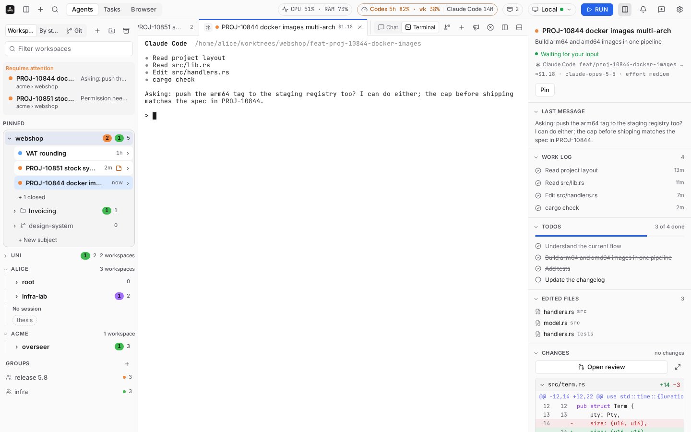
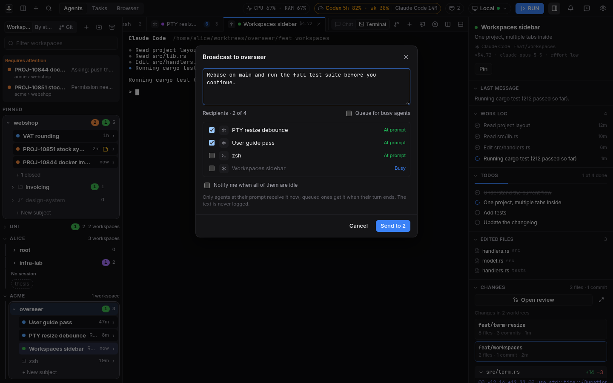
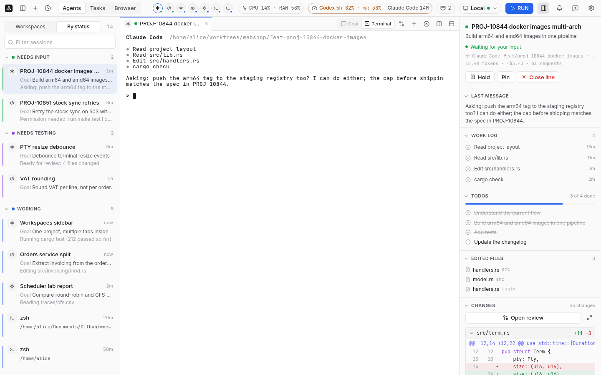
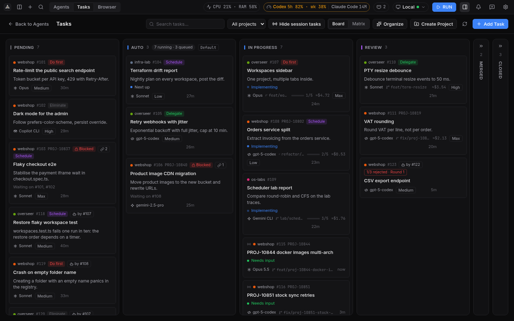
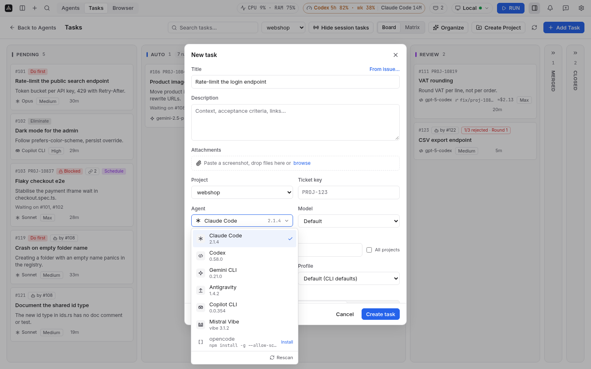
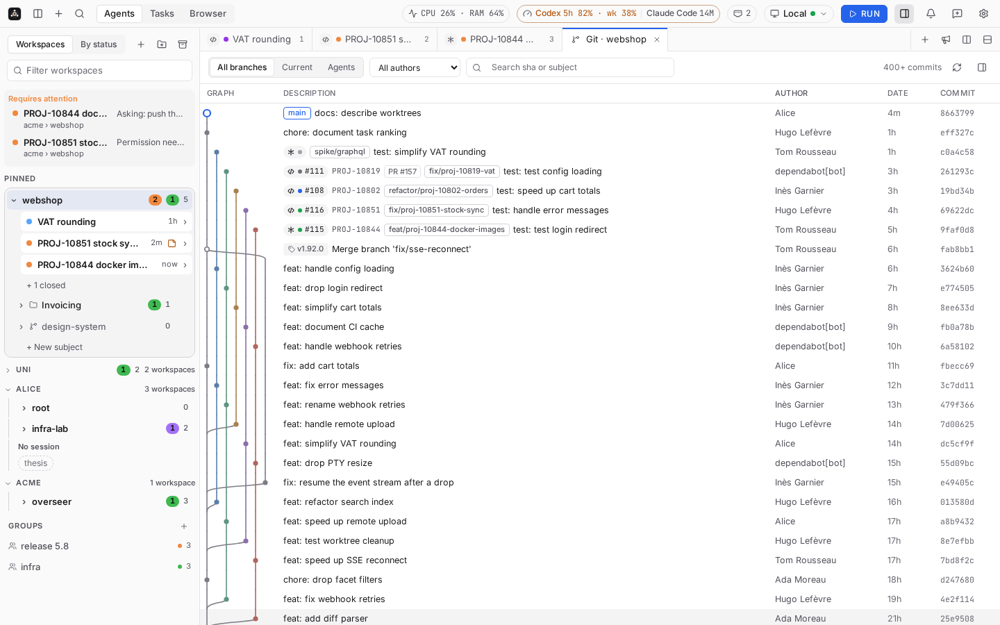
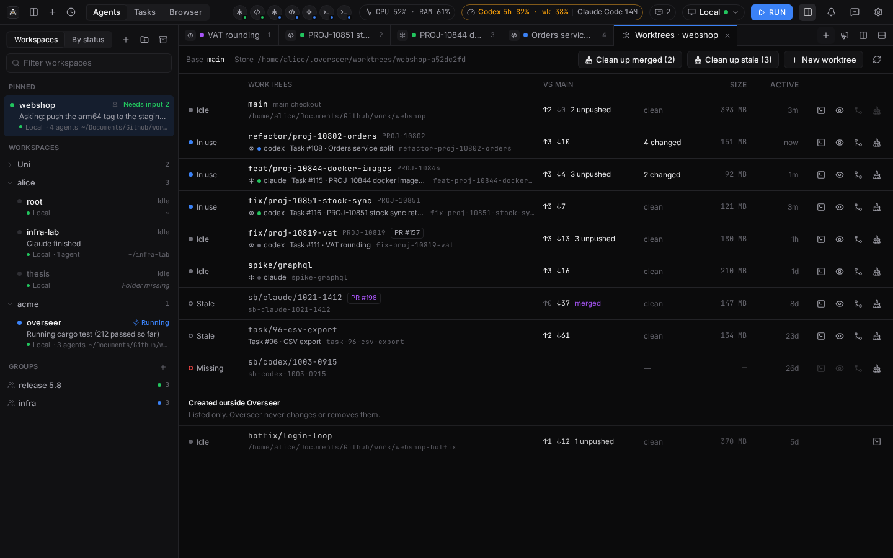
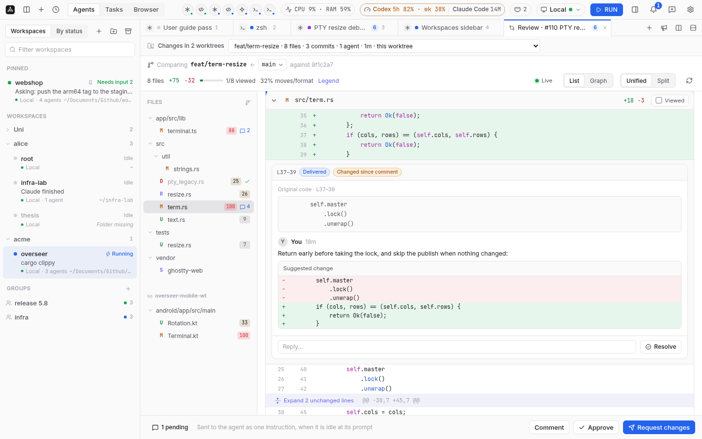
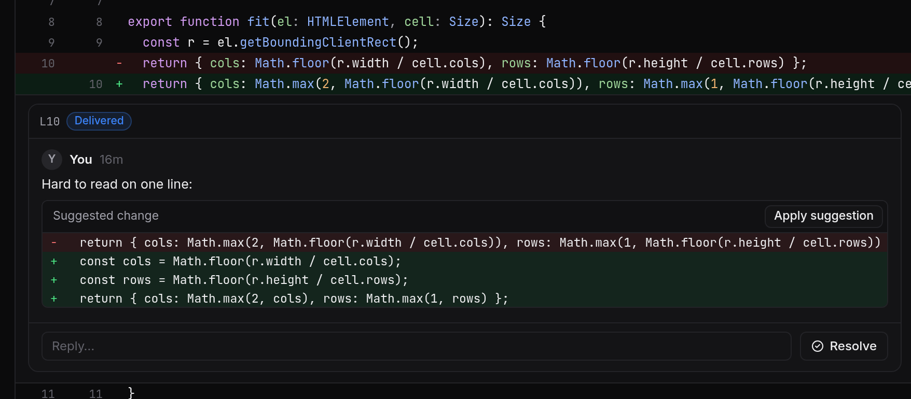

# Overseer desktop app

A desktop client for the Overseer daemon: every agent session (line) with its live terminal,
activity and diff, a task board that starts agents in their own worktrees, a built-in browser,
and the same experience on a remote machine over SSH. Tauri 2 (Rust) + Svelte 5 + TypeScript.
Sessions belong to the daemon: closing the app stops nothing.











## Develop

```
pnpm install                 # once, in app/
pnpm dev                     # browser at http://localhost:1420, mock daemon (no Tauri needed)
pnpm tauri dev               # desktop window, real daemon (VITE_MOCK=1 for the mock)
pnpm test                    # vitest: stores, reducer, mock daemon, grouping, workspaces, tabs, broadcast, kanban, palette, connection, review, git graph, worktrees
pnpm check                   # svelte-check / TypeScript
cargo test  --manifest-path src-tauri/Cargo.toml
cargo clippy --manifest-path src-tauri/Cargo.toml --all-targets -- -D warnings
```

From the repository root: `make app-dev`, `make app-build`, `make app-test`. `make app-test` also
builds the daemon and runs `daemon_it`, an integration test that starts a real `overseer
daemon --detach` in a temporary HOME and state dir and drives version, tasks, projects and a PTY
over the WebSocket through the app's own transport (it is skipped when no daemon binary is found;
set `OVERSEER_BIN` to use another one), and `remote_it`, which runs the whole remote path
(bootstrap, install, tunnel, three terminals, port forward, killed link, reconnect, scrollback)
through a fake local `ssh`. `make test-remote` (needs Docker) runs the same scenario against real
sshd containers: a `Match` block, `ProxyJump` via a bastion, `ProxyCommand nc %h %p`, a host key
prompt answered from the app, and exactly one TCP connection on the server side while everything
is open. Containers, network and image are labelled `overseer-remote-it` and removed after.

The mock (`src/lib/mock.ts`) is used with `VITE_MOCK=1` or whenever the page runs outside Tauri.
It serves the nine agents of `/v1/agents` (claude, codex, gemini, agy, copilot and shell installed;
opencode, amp and cursor not), 12 lines (some Gemini, Copilot and Antigravity; `/activity` answers
409 for agents without session files), 14 ranked tasks, projects (`POST /v1/projects` included),
folders and workspaces (Uni ▸, alice ▾ root and infra-lab, acme ▾ webshop and overseer, webshop
pinned), two groups (release 5.8, infra), broadcast with queueing and hold dry runs,
diffs, a fake terminal per agent and the remote connection steps; open `#kanban` or `#browser` to
start on another view. `src/lib/review/mock.ts` serves the review routes for the worktree of the
in-testing task "PTY resize debounce" (five files: modified, renamed, deleted, untracked) with
threads in every state (pending draft, queued, delivered, addressed with an agent reply,
resolved, changed since comment, outdated, a suggestion that applies); a submit goes queued then
delivered. `#review` opens that review in a tab (mock only). Per project the mock also has a
generated history of about 3000 commits (branches, merges, an octopus merge, tags, remote refs,
agent branches with tasks and PRs) and its worktrees (in use, idle, stale, missing, an orphan);
`#graph` or `#worktrees` opens that tab, and `?theme=light|dark` overrides the theme for one load.

Linux needs the WebKitGTK 4.1 development packages (`libwebkit2gtk-4.1-dev`, `libsoup-3.0-dev`).

## Build

```
pnpm tauri build                     # installers in src-tauri/target/release/bundle
pnpm tauri build --debug --no-bundle # quick debug binary
```

Measured on Linux x86_64 (2026-10-29, `vite build` output; memory with a `VITE_MOCK=1` release
build under `Xvfb` with Mesa EGL, 25 s after start, agents view, summed `smaps_rollup` of the app
and its WebKit children):

| | |
|---|---|
| JS loaded at start | 172 KB (59 KB gzip); 315 KB in total |
| Lazy chunks | terminal 72 KB (20 KB gzip) + `ghostty-vt.wasm` 423 KB (126 KB gzip) as a separate asset; Tasks 19 KB, Settings 7 KB, Browser 5 KB; review 38 KB (13 KB gzip) + 15 KB CSS, its highlighter (highlight.js core + 19 languages) 85 KB (28 KB gzip), loaded on the first highlighted file |
| CSS | 30 KB (6 KB gzip) at start + 9 KB in the lazy views; fonts (Inter, JetBrains Mono, latin) 115 KB woff2 |
| Release binary | 6.9 MB |
| Idle memory, release build, whole process tree | 358–362 MiB PSS (492–503 MiB RSS): app 83–88, WebKit web 246–256, WebKit network 22–23 (software rendering; unchanged by the lazy views) |

Git graph (measured 2026-10-29, Linux x86_64, `pnpm test` and headless Chromium on the mock,
software rendering): lane layout of 10 000 commits 50 ms in one pass (`layout.test.ts`; pages
are laid out incrementally, so later pages cost only their own rows); about 50 row elements in
the DOM whatever the history length, one canvas per visible window; scrolling 1 200 rows by
script while pages load: median frame 21 ms, p95 45 ms (idle baseline in the same headless
browser: 16.7 / 35 ms). The daemon sends parents only (no layout), about 330 bytes a commit
with refs. Release daemon on a synthetic 10 000-commit repository with 25 branches (machine
under load): a 300-commit page in 85–95 ms (98 KB), 2 000 commits in 110 ms (454 KB), the page
at offset 9 000 in 116 ms, a commit's detail in 23 ms, the worktrees list in 30–45 ms.

The terminal loads the WASM with `Ghostty.load(url)`; a small Vite transform drops the copy that
ghostty-web embeds as base64 (`vite.config.ts`).

## Using it

- **Workspaces** (one project, multiple tabs inside): the sidebar is a tree of folders and
  workspaces, pinned ones on top. Each row shows the most urgent state of its agents (Needs input >
  Running > Needs testing > Idle) and their count, the last status line, the host with its
  connection state and the folder. Every project of the daemon gets one; `+` adds any folder.
  Drag to reorder, into a folder or onto Pinned; right-click to rename, pin, move, archive,
  delete, broadcast, hold or resume all, or be notified when all agents are idle.
- **Workspace tabs**: selecting a workspace shows its own tab strip: agent sessions, shells,
  browser and review tabs (a small registry in `lib/tabs.ts`; the review view mounts
  `ReviewTab.svelte` when it exists), with agent glyph and status dot. `+` starts an agent or a
  shell in the workspace folder; drag to reorder; split right or down. Cmd/Ctrl+1–9,
  Cmd/Ctrl+Shift+[ ], Cmd/Ctrl+T. The order is stored in the daemon.
- **By status**: the former sidebar, sessions grouped Needs input, Needs testing, Working, Pushed,
  Idle, Held. Arrows move, Enter opens, Left/Right fold a group. Selecting a held line offers
  "Resume in terminal". Ctrl/Cmd+click selects several sessions for a group or a broadcast.
- **Groups and broadcast**: groups of lines across workspaces (a line can be in several), shown
  as a sidebar section and as tabs. Broadcast types one message into every selected agent at its
  prompt, skips or queues the busy ones, and reports sent / queued / skipped per agent. Hold all
  shows the dry-run checks before acting.
- **New session**: the + menu (title bar) or the palette starts any installed agent (Claude Code,
  Codex, Gemini CLI, Antigravity, opencode, Amp, Copilot CLI, Cursor Agent) or a shell in a daemon
  term (`POST /v1/terms {agent}`). Agents that are not installed are listed greyed with their install
  command.
- **Terminal**: ghostty-web over the daemon's PTY (`/v1/terms/{id}/io`). Tabs per pane, split
  right or down, drag the divider, kill the process (two clicks). Only visible terminals are
  mounted; the daemon replays the scrollback when a terminal is shown again.
- **Activity panel**: work log, todos, edited files, live diff, hold / pin / close / open PR. Agents
  without session files (Antigravity, Copilot CLI, …) show the terminal, the diff and basic info.
- **Tasks**: Pending, Auto, In progress, In testing, Completed. Drag cards across or within columns
  (the board and columns scroll near their edges), or focus a card and press Space, arrows,
  Space; the order is the task's `rank`. In progress opens the agent's terminal; In testing opens
  the review (approve, reject, commit). Add Task picks the agent, its model and effort from
  `/v1/agents`. Create Project registers a repository with the daemon (`POST /v1/projects`).
- **Review**: a GitHub-style review of a worktree, opened as a workspace tab ("Open review" in the
  activity panel's Changes, "Review changes" in the palette, Open review in the Kanban review), or
  inside the In testing review dialog (Approve / Reject / Commit kept below it). Files changed
  against the merge base of the branch with its base, plus uncommitted and untracked files; file
  tree with status letters, comment counts and "viewed" (reset when the file changes again);
  unified or split diff, syntax highlighting, unchanged lines collapsed (expand per gap). It
  updates live while the agent edits (`review.changed`). Click a line number's `+` (drag or
  shift-click for a range) to comment; Ctrl/Cmd+Enter adds it to the review as a draft; "Suggest
  change" inserts a ```` ```suggestion ```` block that can be applied to the worktree. Threads have
  replies, resolve / reopen and a state: Pending, Queued / Delivered, Addressed (the agent
  answered through MCP), Resolved, plus Changed since comment and Outdated (shown at the top of
  the file with the original code). The bar at the bottom sends every draft as one instruction
  (Comment, Request changes, Approve) to the agent working in the worktree, typed only when it is
  idle at its prompt, else queued. Tabs show the number of unresolved threads of their worktree.
- **Command palette**: Ctrl/Cmd+K (sessions, new agent sessions, views, switch host, disconnect,
  theme, splits). **Settings**: Ctrl/Cmd+, (theme auto/light/dark, language, font size, task
  defaults, auto concurrency, hosts, server binaries folder, notifications).
- **Git graph** and **Worktrees** tabs: from a workspace's `+` menu or the palette, one tab each
  per project (tab kinds `graph:<project>` and `worktrees:<project>` in `lib/tabs.ts`, mounting
  `lib/git/GitGraphTab.svelte` and `lib/git/WorktreesPanel.svelte`; `#graph` / `#worktrees`
  open them at start).
  - *Graph*: lanes and merges drawn on a canvas for the visible rows only, branch / remote / tag
    labels (the checked-out branch in the accent, remotes hidden when they match their local
    branch), and on the tip of every branch Overseer knows its agent glyph with the line's
    status dot, task number, ticket key and PR state. All branches / current / agents only,
    author filter (other authors dimmed), search by sha or subject (Enter / Shift+Enter step
    through matches). Pages of 400 commits load while scrolling; `git.changed` refetches and keeps
    the selection. Arrows move, Enter opens the commit: message, files, diff, and actions: new
    worktree at this commit, create branch, cherry-pick into a worktree (pick the target, then
    confirm), copy sha, open on GitHub.
  - *Worktrees*: the main checkout and Overseer's worktrees (state in use / idle / stale /
    missing, agent and line, task, ahead/behind the base, uncommitted changes, PR, size, last
    activity) with open terminal, review, merge the base into it and clean up. Clean up always
    shows the daemon's dry-run plan first (what is removed, which branch is kept and why, or why
    it is refused) and runs only on confirm; "Clean up stale" does the same for every stale or
    missing one. Worktrees created outside Overseer are listed separately, read-only.
  - Agent sessions started from the `+` menu, the palette or the title bar in a project's
    workspace run in a new worktree of that project; tick "Run in current checkout" in the `+`
    menu to start them in the checkout instead (remembered). A task's Start offers "Start in a
    new worktree" and "Start in the current checkout".
- **Notifications**: OS notifications when a session needs input, a task is ready for testing, a
  session finishes or fails; the badge counts sessions waiting for input.

## Updates

Release builds check for a new version at startup and every 6 hours; "Check for updates" is in
the palette and in Settings > Updates. When one is out, a small "Update 0.x.y" pill appears in the
title bar; it opens the release notes and **Download & install**, with download progress, then
**Restart to finish** (or **Later**). The download is verified against the minisign public key in
`tauri.conf.json` (`plugins.updater.pubkey`) before it is installed. The notes come from
`latest.json`, or from the GitHub release body when the manifest has none.

The releases are public, so a token with no scopes is enough; every request carries it. The app takes the first of:

1. the token saved in Settings > Updates (stored in the app config folder as `github-token`,
   mode 0600, never shown again or logged);
2. `OVERSEER_GITHUB_TOKEN`, `HOMEBREW_GITHUB_API_TOKEN`, `GITHUB_TOKEN`;
3. `gh auth token` (`gh` on the `PATH`, `/opt/homebrew/bin` or `/usr/local/bin`, 3 s timeout).

With none, the check stays quiet: Settings and the update dialog say "Sign in to GitHub to get
updates".

The check lives in Rust (`src-tauri/src/updater.rs`): it asks `GET /repos/.../releases/latest`
for the `latest.json` asset, then runs `tauri-plugin-updater` on that asset's API URL with
`Authorization: Bearer <token>` and `Accept: application/octet-stream`; the plugin sends the same
headers when downloading the bundle (the redirect to the storage host drops the
`Authorization` header).

What updates itself depends on how the app was installed:

| Install | Update |
|---|---|
| macOS `.dmg` (app outside Homebrew) | self-update (`.app.tar.gz`) |
| Homebrew cask (a `Caskroom/overseer` folder or the app inside one) | **Update** runs Homebrew from the app (below); the command stays copyable |
| Windows NSIS installer | self-update (passive installer, the app restarts) |
| Linux AppImage | self-update (the AppImage file is replaced) |
| Linux `.deb` / `.rpm` | the dialog links the release page |

On a Homebrew install, **Update** runs, from the app (`update_brew` in `updater.rs`):

1. `brew` from `/opt/homebrew/bin`, `/usr/local/bin`, then the `PATH`;
2. `brew update` (so the tap sees the new version), `brew upgrade --cask basilelt/tap/overseer`,
   and `brew upgrade --formula basilelt/tap/overseer` when `brew list --formula overseer` says the CLI is
   installed; then `brew list --cask --versions overseer` must show the offered version or a
   newer one (the tap may already carry a later release), or the upgrade output must say
   `was successfully upgraded` without the installed version being older; the dialog then names
   the version Homebrew installed;
3. with `HOMEBREW_GITHUB_API_TOKEN` set to the token above (scrubbed from the output, never shown),
   `HOMEBREW_NO_ENV_HINTS=1`, no colours, `GIT_TERMINAL_PROMPT=0`, stdin closed, and the Homebrew
   `bin` folders first in `PATH` (a Finder-launched app has a bare `PATH`; the git credential
   helper may need `gh`).

The dialog shows the current step, the last output line and the full output in a collapsible
area. When it is done, **Restart to finish** removes the quarantine flag of
`/Applications/Overseer.app` (or `~/Applications`), starts it with `open -n` and quits, so the
new bundle runs. Failures say what to do: tap not trusted (**Trust and retry** runs
`brew trust <tap>` first), token refused (401/403/404, or git cannot read the tap), Homebrew not
found, or Homebrew still on the old version. The upgrade uses the fully qualified
`basilelt/tap/overseer`, which makes Homebrew trust the cask and formula, so an install made
before tap trust existed upgrades without the trust prompt. The copyable
`brew update && brew upgrade --cask basilelt/tap/overseer` stays under the button.

Release notes are rendered from their Markdown (`src/lib/release-notes.ts`): headings, bullets,
bold, inline code and http(s) links, which open in the system browser; compare links are reduced to
their text and commit links to short sha chips. Everything else is shown as text.

Development builds (`pnpm tauri dev`) do not check on their own; the palette command still works.
How releases are signed and how `latest.json` is built: `docs/ci.md`, "App updates".

## Troubleshooting

### Logs

The app writes its own log, rotated at 5 MB with 5 files kept (`app.log`, `app.log.1`..`.4`):

| OS | Folder |
|---|---|
| macOS | `~/Library/Logs/io.github.basilelt.overseer/` |
| Linux | `~/.local/share/io.github.basilelt.overseer/logs/` (`$XDG_DATA_HOME` when set) |
| Windows | `%LOCALAPPDATA%\io.github.basilelt.overseer\logs\` |
| Android, iOS | the app's private data (`logs/`); use Copy all |

It records the start (version, OS, build, code signature on macOS), the connection lifecycle
(`ssh -G` resolution, in-app relay or not, bootstrap steps, reconnects and their cause, hot
upgrade or restart), daemon errors and slow requests (over 2 s), slow commands (over 1 s),
terminal attach and close, updater events, frontend errors (`window.onerror`, unhandled
rejections, `console.error`, selected warnings; rate limited) and freezes. Tokens,
passwords, `Bearer` values, GitHub and `sk-` keys and URL passwords are masked; terminal contents
and prompts are never logged.

**After a crash, freeze or kill.** A `session` file is written at start and removed on a clean
exit. When the next launch finds it, a "Previous session ended unexpectedly" dialog opens (a full
screen sheet on phones) with what happened (crash, freeze, killed or force-quit), the crash report
if there is one, the last 500 lines of the app log and, once connected, the last 300 lines of the
server's `~/.overseer/daemon.log` (`GET /v1/logs`). **Copy all** puts everything in one
plain-text block ready to paste into a bug report; **Save as file** writes it to Downloads;
**Open log folder** opens the folder above. The report stays until you dismiss it.

- A Rust panic writes `crash-<ms>.txt` (location, message, thread, backtrace, last 200 log lines)
  next to the log; the 10 newest are kept. Release builds are stripped, so backtraces show
  addresses only; the location and message are what matters.
- A watchdog pings the window every 2 s; after 5 s without an answer it logs "UI unresponsive for
  N s" with the current view, the commands in flight and the last one completed, again every 10 s,
  and "UI responsive again" when it recovers. Hidden windows and backgrounded phones are not
  watched, and a phone killed in the background is not reported.

**Any time.** Palette > "Show logs", Settings > Diagnostics, or More > Show logs on a phone: a live
view of the app log (refreshed every 2 s) and the server log, with a level filter, a search and
the same buttons.

## Remote mode

Click the host chip (top right) or "Connect to host…" in the palette, then pick a host from
`~/.ssh/config`, a recent host, or type `user@host[:port]`. The app:

1. resolves the host with `ssh -G` (shown as `alias → hostname:port as user via ProxyJump …` in
   the dialog and in errors);
2. runs the system `ssh` once (your config, agents, `ProxyJump`/`ProxyCommand`, `Match` blocks,
   known hosts: exactly what `ssh <host>` does). Host key, passphrase and password prompts appear
   in the app through `SSH_ASKPASS`; a new host key is added to `known_hosts` only after you click
   "Trust and connect";
3. in that session, reports `uname -sm` and the installed server version, receives the matching
   binary when it is missing or another version (sha256 checked), runs `overseer daemon
   --detach`, then `exec overseer proxy`;
4. multiplexes every request, event stream, terminal and forwarded port over that one connection
   (flow-controlled streams, 15 s keepalive). Nothing listens on a TCP port on the server.

When the link drops (sleep, network change, killed session) the banner shows "Reconnecting"
and the app reconnects with backoff; terminals re-attach and the daemon replays their scrollback.
Ports opened by programs in remote terminals are forwarded automatically to the same local port
(the next free one when taken), with a notification; the Ports panel (title bar chip or palette)
lists, opens, copies, stops and adds forwards and holds the auto-forward, ignore list and
localhost-only settings. See [ADR 0028](../docs/adr/0028-remote-tunnel-and-ports.md).

Troubleshooting "No route to host" on macOS while `ssh` works in Terminal: macOS Local Network
privacy. On macOS the app opens the TCP connection itself and hands it to `ssh` through a loopback
relay (`--ssh-relay`; `OVERSEER_SSH_RELAY=0` disables it), so only Overseer needs the
permission. If it still fails, the Connect dialog shows "Allow local network access": open Privacy
& Security > Local Network, switch Overseer on (or off and on again: an ad-hoc signed build
changes identity on every update and macOS may keep the grant on an older one), quit and reopen
Overseer, then Try again. Details lists the resolved addresses, interface and signature.
Release builds are signed with a stable certificate (`Overseer Self-Signed`, see
[docs/ci.md](../docs/ci.md#macos-signing)), so after the first such install one toggle survives
later updates. Workaround on an ad-hoc build: macOS attributes the network access of a process
started from Terminal to Terminal, so starting the app from Terminal connects right away:
`/Applications/Overseer.app/Contents/MacOS/overseer-app`.

The binaries come from the app's resources (`src-tauri/resources/server/<os>-<arch>/overseer`,
for `linux-x86_64`, `linux-aarch64` (static musl), `darwin-x86_64`, `darwin-aarch64`) or from the
server binaries folder in Settings, laid out the same way. `make app-build` runs `make dist` and
`make app-server`, which copies the static Linux binaries into the resources. Passphrase-protected keys must be in
the agent or are asked for in the app.

Local mode connects to `<state>/daemon.sock` (`OVERSEER_SOCKET` and `OVERSEER_STATE_DIR`
override it) and starts `overseer daemon --detach` when nothing answers, using the binary next
to the app, in its resources, in the server binaries folder, or on `PATH`. On Windows it reads
`%LOCALAPPDATA%\overseer\daemon.json` (loopback address and token).

## Mobile

The same app runs on Android and iOS (builds and releases: ADR 0032), adapted to a phone and
remote only: it connects to a server where the daemon runs, so the phone and the desktop show the
same sessions, tasks and reviews at the same time and stay in sync through the daemon. See
[ADR 0033](../docs/adr/0033-mobile-app.md).

**Connecting.** A phone has no `ssh` binary: the app has its own SSH client and keeps its own list
of hosts (Connect screen: label, host, port, user, optional ProxyJump through one bastion, key or
password). It runs the server installed on that host (`~/.overseer/server/…`) and multiplexes
everything over one SSH session, like the desktop. When the host has no server, or an older one,
the phone downloads the server of its own version from the GitHub release (with the GitHub token
of Settings > Updates / GitHub access), checks it against `SHA256SUMS`, uploads and starts it;
a running older daemon is hot-upgraded like from the desktop. The first connection asks to trust the host key (fingerprint shown); a changed key is
refused until you remove the trusted key in the host's settings.

**Adding the device key.** On first launch the app creates an Ed25519 key for this phone and keeps
it in the Android Keystore / iOS Keychain. More > Device key shows the public key and its
fingerprint, with **Copy public key** and **Copy install command**. Run the install command on the
server (for example in a shell tab of the desktop app, connected to that server):

```
mkdir -p ~/.ssh && chmod 700 ~/.ssh && touch ~/.ssh/authorized_keys && chmod 600 ~/.ssh/authorized_keys && (grep -qxF 'ssh-ed25519 AAAA… overseer-android' ~/.ssh/authorized_keys || echo 'ssh-ed25519 AAAA… overseer-android' >> ~/.ssh/authorized_keys)
```

or paste the public key into `~/.ssh/authorized_keys` yourself (what `ssh-copy-id` does). Password
authentication works too (choose it per host; "remember password" stores it in the secure store).

**Off the LAN.** The phone must reach the server's SSH port. Install NetBird or Tailscale on the
phone and the server and use the overlay name or address as the host, or use a ProxyJump bastion
that is reachable from the internet.

**Sleep and roaming.** The connection sends keepalives every 15 s and reconnects with backoff when
the phone sleeps or changes network; coming back to the app retries at once. Terminals re-attach
and the daemon replays their scrollback.

**On a phone:**

- The sidebar is a drawer (menu button): workspaces, groups, by status. A bottom bar switches
  Agents, Tasks, Review and More; the workspace tabs are a row of chips.
- Terminal: an accessory row above the keyboard (Esc, Tab, Ctrl — tap for the next key, double tap
  to lock — Alt, arrows, `|` `~` `/` `-`, newline), Paste, pinch to zoom the font, long press to
  copy. **Compose** opens a sheet for a multi-line message to the agent, typed when it is idle (or
  now), like a broadcast.
- When the phone and the desktop show the same terminal, the last one focused sets its size; the
  other shows "Resized for phone · Fit" (or "Sized for desktop · Fit") and takes the size back
  when you focus it or tap Fit.
- Tasks: one column per screen, swipe or pick a column; long press a card (or its menu) to move it.
- Review: single-column diff, a file picker, tap a line number to comment.
- Notifications (needs input, ready for testing, finished, failed) while the app runs. Push
  notifications when the app is closed are not available yet (future: a relay through the hosted
  API).

**Mock.** `pnpm dev:mock` then open `http://localhost:1420/?phone=1` (any window width) for the
phone layout with two saved hosts, a device key and the connection steps.

## Performance

Target: under 1 % of one core with five idle terminals and the window focused, about 0 % hidden or
minimised. Nothing in the app may poll or animate continuously.

- **Terminal rendering.** ghostty-web 0.4.0 starts a `requestAnimationFrame` loop per terminal in
  `Terminal.startRenderLoop()` that never stops, and its renderer redraws the cursor row on every
  frame when `cursorBlink` is on. `lib/termrender.ts` patches the pinned version at load time
  (`installOnDemandRendering`, called from `loadGhostty`): `startRenderLoop` registers the terminal
  with one shared `FrameScheduler` instead, and the triggers that relied on the loop mark it dirty
  (`write`/`writeInternal`, resize, reset/clear, scrolling, selection via
  `SelectionManager.requestRender`, link hover, font change, focus). The scheduler paints each
  dirty terminal at most once per frame, skips terminals outside the viewport
  (IntersectionObserver) and every terminal while the document is hidden (they catch up when
  shown), and caps terminals without keyboard focus at 30 fps. The cursor blink is the scheduler's
  own 600 ms timer, running only for the focused terminal while the window is focused. A render
  error is logged without stopping the other terminals. `termrender.test.ts` checks that the
  installed ghostty-web still has the members the patch touches; if a new version lacks them the
  patch is skipped with a console warning and ghostty-web's own loop runs, so bumping
  ghostty-web means re-reading `startRenderLoop` and `CanvasRenderer.render` first.
- **Inactive window.** `lib/presence.ts` follows `visibilitychange`, window focus/blur and
  Tauri's focus event, and sets `html.inactive` (unfocused or hidden), which pauses spinners and
  pulses, and `html.hidden-window`, which pauses every CSS animation. Entrance animations keep
  running while unfocused so a dialog opened in the background still appears. Long-running states use static indicators; spinners are only for short waits.
- **Timers.** No polling loop runs in the webview: the only periodic timers are the update check
  (hours), the status list's relative times (30 s, only while visible) and the cursor blink.
  Daemon events are applied by `reduce.ts`, which returns the previous snapshot when an event
  changes nothing, so the sidebar does not re-render.
- **Only visible tabs are mounted.** A pane mounts a `TerminalPane` for its active tab only, so at
  most two terminals (a split) exist at a time; other tabs reattach (with the server's replay) when
  shown.
- **Measured in CI.** The `perf` job builds the app with `VITE_MOCK=1 VITE_PERF=1`, which mounts
  `lib/perf/Harness.svelte` (sidebar plus 5 mock terminals; after 45 s one streams 10 lines every
  50 ms), runs it under Xvfb and samples `/proc/<pid>/stat` for the app and its WebKit children
  (`scripts/perf-cpu.sh`). It fails at 3 % of one core idle or 80 % streaming. Run it locally with
  `VITE_MOCK=1 VITE_PERF=1 pnpm --dir app tauri build --no-bundle` then
  `xvfb-run -a scripts/perf-cpu.sh app/src-tauri/target/release/overseer-app`. Xvfb has no
  window manager, so the window is unfocused there and the cursor does not blink.

## Architecture

```
app/src                       Svelte 5 (runes), no UI framework
  lib/client.ts               DaemonClient interface; picks tauri-client.ts or mock.ts
  lib/api.ts                  typed routes (contract/app-daemon.md, protocol 1)
  lib/state.svelte.ts         app store: connection, snapshot, selection, overlays
  lib/reduce.ts               SSE events -> snapshot (pure)
  lib/termrender.ts           on-demand terminal frames, patches ghostty-web's render loop
  lib/presence.ts             window visible/focused, drives html.inactive
  lib/grouping.ts             sidebar groups (pure)
  lib/workspaces.ts           workspace membership, status aggregation, tree, drag plans (pure)
  lib/tabs.ts, broadcast.ts   tab kinds and shortcuts, broadcast dialog logic (pure)
  lib/wsactions.ts            workspace, folder and group menus and actions
  lib/agents.ts               agent list helpers: order, names, model/effort choices (pure)
  lib/kanban.ts, workspace.svelte.ts, conn.ts, notify.ts, diff.ts, fuzzy.ts   pure logic + tests
  lib/git/                    git graph and worktrees: layout.ts (pure lane layout, incremental
                              over pages), view.ts (virtual window, labels, filters), loader.ts,
                              draw.ts (canvas), api.ts, mockGit.ts, strings.ts (gt over i18n), components
  lib/review/                 live review: api.ts (routes, contract §11), rows.ts (unified/split
                              rows, gaps, thread placement, file tree), threads.ts (states,
                              suggestions, batching, counts), draft.ts (comment box), keys.ts /
                              open.ts (tab keys `review:wt:|line:|task:`), store.svelte.ts,
                              counts.svelte.ts (tab badges), highlight.ts + hljs.ts (lazy),
                              linediff.ts + mock.ts (mock daemon)
  lib/i18n.svelte.ts          every string, English and French
  lib/components/...          title bar, sidebar, workspace, panel, kanban, overlays, browser,
                              review (ReviewView, FileTree, FileDiff, Thread, CommentBox, SubmitBar,
                              ReviewTab, ReviewBadge)
app/src-tauri/src             Rust
  commands.rs                 daemon_request, daemon_events, term_attach/write/resize/detach
  conn.rs                     connect state machine, local auto-start, reconnect with backoff
  transport.rs                DaemonConn { Local, Loopback, Tunnel }: one stream per request
  http.rs, sse.rs, ws.rs      HTTP/1.1, SSE and WebSocket over any AsyncRead + AsyncWrite
  ssh.rs                      system ssh process, bootstrap/install in the same session
  sshg.rs                     `ssh -G` parsing, ProxyCommand tokens, ProxyJump chain, description
  mux.rs                      stream multiplexer client (contract §8a), flow control, keepalive
  askpass.rs                  SSH_ASKPASS helper (the app binary) and its prompt endpoint
  forward.rs                  port forwarding manager (auto/manual, settings, local listeners)
  sshconfig.rs                host list for the Connect dialog
  install.rs                  remote platform, binary lookup
  browser.rs                  child webview (Tauri `unstable`), open_external (desktop only)
  direct/                     in-process SSH for phones: client.rs (russh, ProxyJump, host key
                              prompt, key/password auth, shared bootstrap + mux), keys.rs (device
                              key), known.rs (known_hosts), hosts.rs (saved hosts), secrets.rs
                              (Keystore / Keychain, file fallback)
app/src/lib/mobile            phone layout: layout.ts (breakpoint, tabs), gestures.ts, accessory.ts
                              (accessory keys, sticky Ctrl), compose.ts, termsize.ts, ui.svelte.ts
app/src/lib/components/mobile shell, drawer, bottom navigation, connect, device key, accessory row,
                              compose sheet
```

The webview never talks to the network: HTTP goes through `daemon_request`, events and terminal
bytes through Tauri channels. See [ADR 0025](../docs/adr/0025-desktop-app.md).
